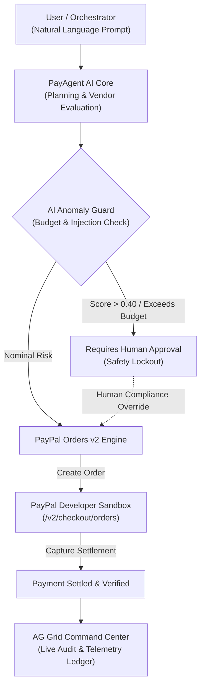

# PayAgent AI 🤖💳

> **Autonomous Agentic Commerce & Smart Merchant Escrow Protocol**  
> *Built for the PayPal AI Hackathon (Devpost) • Integrating PayPal Developer Platform & AG Grid Community*

[](LICENSE)
[](https://developer.paypal.com/)
[](https://www.ag-grid.com/)
[](https://nodejs.org/)

---

## 🌟 Overview

Autonomous AI agents (personal shoppers, procurement bots, developer assistants) are rapidly taking over multi-step workflows. However, **giving an LLM autonomous access to credit cards or unrestricted bank accounts is a critical security vulnerability.**

**PayAgent AI** bridges the gap between autonomous AI agents and real-world financial rails. It acts as an **Agentic Commerce Protocol & Security Gate**:
1. **Translates Unstructured Agent Goals** into structured commercial purchase units.
2. **AI Anomaly & Safety Guard**: Evaluates orders for prompt injection, sudden budget spikes, or untrusted vendors before touching payment rails.
3. **PayPal Orders v2 Settlement**: Directly interfaces with PayPal's sandbox APIs (Capture & Checkout) for verified, compliant payment execution.
4. **AG Grid Command Center**: Delivers real-time telemetry, transaction filtering, and audit compliance for thousands of high-velocity agent settlements.

---

## 🏗️ Architecture



---

## 🎯 Hackathon Category Alignment

| Prize Track | Implementation & How PayAgent AI Qualifies |
|---|---|
| **1st / 2nd / 3rd Place** | Full end-to-end working commercial solution addressing the biggest unsolved challenge in autonomous agent deployment: financial safety. |
| **Best Use of Agentic Commerce ($5,000)** | Fully native agentic workflow: interprets procurement intents, selects vendors, evaluates risk, and executes programmatic PayPal checkout. |
| **Best Use of PayPal + AI ($5,000)** | Deep integration of PayPal Orders v2 API with multi-step AI reasoning and adversarial prompt-injection detection. |
| **Best Use of AG Grid ($5,000)** | Custom AG Grid Community v32 implementation with custom status badge renderers, anomaly index gauges, CSV export, quick filter, and real-time state updates. |
| **Best Use of Render** | Production-ready `render.yaml` blueprint with zero-dependency deployment configuration. |

---

## 🚀 Quick Start (Runs in 10 seconds)

### Prerequisites
- Node.js (v18+)
- npm

### 1. Clone & Install
```bash
git clone https://github.com/your-username/payagent-ai.git
cd payagent-ai
npm install
```

### 2. Start the Server
```bash
npm start
```
The server will start instantly at **`http://localhost:4000`**.

### 3. Open in Browser
Open `http://localhost:4000` to interact with:
- The **Agent Procurement Terminal** (try the preset prompts: *GPU Compute*, *Domain Name*, or *Trigger Anomaly Guard*).
- The **Interactive PayPal Sandbox Checkout**.
- The **AG Grid Command Center** (live sorting, filtering, and CSV export).

---

## ⚙️ Configuration (.env)

By default, PayAgent AI runs in an **Interactive Sandbox Simulator** that is 100% functional out of the box with zero external configuration needed.

To connect your own PayPal Developer Sandbox credentials:
1. Copy `.env.example` to `.env`:
   ```bash
   cp .env.example .env
   ```
2. Insert your credentials from the [PayPal Developer Dashboard](https://developer.paypal.com/dashboard/applications/sandbox):
   ```ini
   PORT=3000
   PAYPAL_CLIENT_ID=your_sandbox_client_id_here
   PAYPAL_CLIENT_SECRET=your_sandbox_client_secret_here
   PAYPAL_API_BASE=https://api-m.sandbox.paypal.com
   ```

---

## 🛡️ Security Features
- **Prompt Injection Defense**: Filters out adversarial commands attempting to siphon funds or bypass authorization constraints.
- **Dynamic Anomaly Scoring**: Flags variance between initial request context and vendor itemization.
- **Dual-Gate Thresholds**: Micro-purchases under authorized limits settle automatically; high-value or elevated-risk orders require cryptographic human-in-the-loop signoff.

---

## 📄 License
This project is open-source under the [MIT License](LICENSE).
